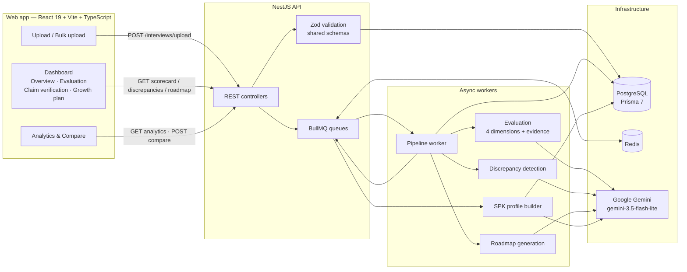
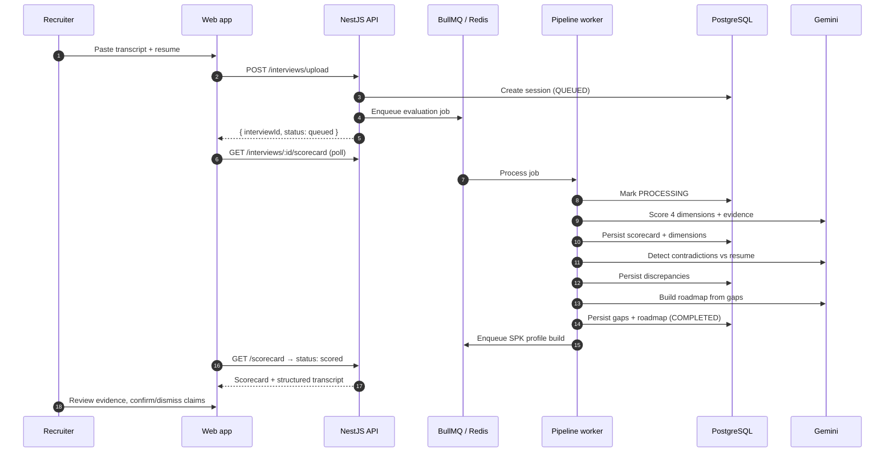

# EchoGrow — Pitch Outline

> **One-liner:** EchoGrow turns a raw interview transcript and a resume into an evidence-backed hiring decision, verified claims, and a personalized growth plan — in seconds.

**Format:** 5–7 minute pitch + 3-minute live demo + Q&A
**Demo script:** [`docs/demo-script.md`](demo-script.md)
**Backup video:** [`docs/assets/echogrow-demo-720p.mp4`](assets/echogrow-demo-720p.mp4)

---

## Slide 1 — Title

**EchoGrow**
*Interview verification & evidence-based upskilling.*

- Team: Hasan Sammour, Raed Alhallaq, Noor Sakhel, Yazan Yousef, Tala Salim, Thekra Jaradat
- Tagline: **From transcript to decision, in one workflow.**

---

## Slide 2 — The problem

Hiring teams are drowning in interview signal and starving for evidence.

- **Interviews are unstructured.** Two recruiters can watch the same conversation and reach different conclusions.
- **Resumes are unverified.** “Led a team of six” may be true — or it may be a claim that nobody checks.
- **Feedback is slow and lossy.** Notes are written hours later, from memory, without quotes.
- **Decisions are hard to audit.** When a hire is challenged, there is no evidence trail.
- **Candidates get a rejection, not a roadmap.** The learning signal disappears.

> The cost is not just time. It is inconsistent decisions, avoidable mis-hires, and a process that cannot explain itself.

---

## Slide 3 — The solution

**An evidence-first pipeline for every interview.**

1. **Ingest** a transcript + resume (paste, text, or PDF).
2. **Evaluate** four dimensions with verbatim quotes:
   - Technical Depth
   - Communication Clarity
   - Domain Experience
   - Problem Solving
3. **Verify** resume claims against what the candidate actually said.
4. **Plan** a week-by-week upskilling roadmap from verified gaps.
5. **Explain** every decision with quotes, confidence, and a human review trail.

**Human-in-the-loop by design:** the model proposes, the recruiter confirms or dismisses.

---

## Slide 4 — Product walkthrough

Use the live demo (or the backup video). The story arc:

**Upload → Overview → Evaluation evidence → Claim verification → Growth plan**

Key moments to point at:

- The **confidence** score and the **time saved** counter.
- The **“View evidence”** panel: the quote highlighted inside the surrounding conversation, with speaker labels and timestamps.
- The **severity + confidence** badges on a contradiction.
- The **week-by-week roadmap** with priorities and resources.
- The **export** options: PDF, Markdown, JSON.

Screenshots: [`docs/assets/screenshots/`](assets/screenshots/)

---

## Slide 5 — Architecture

**Why this shape?**

- **Queue-first:** uploads return immediately; long LLM work runs in BullMQ with retries, progress tracking, and a watchdog.
- **Schema-first:** the same Zod contracts validate API responses and power the web types (`packages/shared`).
- **Evidence-first:** every LLM output must cite a verbatim quote; the UI renders the quote in context.
- **Portable output:** the SPK profile is a versioned JSON contract for downstream tools.

---

## Slide 6 — Data flow (one interview)

---

## Slide 7 — Key metrics

### What we measure

| Metric | Definition | Why it matters |
| --- | --- | --- |
| **Time saved** | Manual review time − EchoGrow processing time | The direct recruiter ROI |
| **Completion rate** | Completed interviews ÷ total interviews | Pipeline reliability |
| **Overall score** | Mean of the four dimension scores (0–5) | Comparable candidate signal |
| **Confidence** | Evidence coverage / model certainty | Tells the reviewer when to look closer |
| **Discrepancies / interview** | Resume claims contradicted by the transcript | Risk surfaced before the offer |
| **Skill gaps / interview** | Verified gaps feeding the roadmap | Candidate development signal |
| **Processing attempts** | Retries per interview | Operational health |
| **Avg processing time** | End-to-end pipeline latency | UX and cost |

### Demo dataset snapshot

> Illustrative values from the seeded demo dataset — **not** production claims. Replace with live numbers after Sprint 5.

| Metric | Demo value |
| --- | --- |
| Interviews analysed | 48 |
| Completion rate | 87.5% |
| Average processing time | ~40 seconds |
| Average manual review time | ~45 minutes |
| Average time saved | ~44 minutes per interview |
| Average overall score | 3.7 / 5 |
| Average discrepancies per interview | 1.8 |
| Average skill gaps per interview | 2.4 |
| Interviews with retries | 4 |

**The headline:** a 45-minute manual review becomes a **sub-minute** evidence-backed report, with a quote for every claim.

---

## Slide 8 — Business value

| Stakeholder | Value |
| --- | --- |
| **Recruiters** | Spend minutes, not hours, turning interviews into decisions. |
| **Hiring managers** | Compare candidates on the same rubric, with evidence. |
| **Compliance / HR** | An audit trail: quote, confidence, reviewer decision, note. |
| **Candidates** | A concrete growth plan instead of a silent rejection. |
| **Agencies** | Bulk-process a shortlist and export portable profiles. |

**Why now?**

- LLM quality is finally good enough for structured extraction with citations.
- Hiring teams are under pressure to justify decisions and reduce time-to-hire.
- Transcripts are already being generated by meeting tools — the missing layer is verification.

---

## Slide 9 — Differentiation

| Generic AI interview notes | EchoGrow |
| --- | --- |
| Free-form summary | Fixed four-dimension rubric |
| “Trust me” scores | Verbatim quote + timestamp for every score |
| No resume cross-check | Contradiction detection with severity + confidence |
| No human trail | Confirm/dismiss + reviewer notes |
| One-off output | Versioned, portable SPK profile + PDF/Markdown/JSON exports |
| Single interview | Analytics, bulk upload, and role-aware candidate comparison |

**Moat:** the evidence contract and the verification workflow — not the prompt.

---

## Slide 10 — Roadmap

| Horizon | Milestone |
| --- | --- |
| **Sprint 5 (now)** | Public deployment, environment hardening, demo readiness |
| **Next** | Authentication & team workspaces, ATS webhooks, retention controls |
| **Later** | Audio ingestion + ASR, Arabic/multilingual interviews, bias & fairness audits, calibrated scoring across interviewers |

**Non-goals for the demo:** autonomous hiring decisions, fully automated rejections, or replacing the human reviewer.

---

## Slide 11 — Risks & mitigations

| Risk | Mitigation |
| --- | --- |
| LLM hallucination | Verbatim-quote requirement, Zod schema validation, human confirmation |
| Provider outage / rate limits | Queue with retries, watchdog, graceful UI states, backup demo video |
| Prompt injection in transcripts | Treat transcript as data, not instructions; validate output shape |
| Privacy / PII | Minimise stored fields, retention policy, access control on the roadmap |
| Cost per interview | Flash-lite model, single-pass prompts, caching, batch processing |
| Unfair scoring | Fixed rubric, confidence gating, human review, bias audits |

---

## Slide 12 — The ask / close

- **Try it:** deployed URL (see [README](../README.md#deployment-status)).
- **Give us:** 5 interview transcripts + resumes from your team for a blind evaluation.
- **Success looks like:** 80%+ of reports accepted without edits, and a 10× reduction in review time.

> **EchoGrow makes hiring faster, fairer, and evidence-based. From transcript to decision, in one workflow.**

---

## Q&A bank

**Q: How do you stop the model from making things up?**
Every score must include a verbatim `evidenceQuote` from the transcript. The API validates the response with Zod, and the UI shows the quote inside the surrounding conversation. If the quote cannot be matched, the evidence panel falls back to the plain quote. A human confirms or dismisses every contradiction.

**Q: Is this replacing recruiters?**
No. It removes the blank-page problem and the note-taking tax. The recruiter still owns the decision; EchoGrow makes that decision explainable.

**Q: What happens if Gemini is down?**
The job stays in the queue, retries with backoff, and the UI shows a clear processing or error state. The SPK build has a 90-second watchdog. For the demo, we also have a recorded backup.

**Q: How is the score calculated?**
Four dimensions, each scored 0–5 against a fixed rubric, with a reason and a quote. The overall score is the mean. Confidence reflects evidence coverage and model certainty — not a probability of being hired.

**Q: How do you handle different roles?**
The rubric is stable, but the comparison view is role-aware: you provide a target role and the model ranks candidates against it, with per-dimension winners and a recommendation.

**Q: What about Arabic transcripts?**
The parser and prompts are language-agnostic today; the roadmap includes dedicated Arabic/multilingual evaluation and RTL UI polish. The demo data is English.

**Q: Where is the data stored?**
PostgreSQL via Prisma. Transcripts, resumes, scorecards, discrepancies, roadmaps, and reviewer decisions are persisted per session. Retention and access controls are on the Sprint 5+ roadmap.

**Q: How long does an interview take?**
The demo pipeline completes in roughly 40 seconds; manual review is modelled at ~45 minutes. Real latency depends on transcript length and provider throughput.

**Q: Can I export the result?**
Yes — PDF, Markdown, and JSON for the roadmap, plus a versioned SPK JSON profile for downstream tools.

**Q: What is the SPK profile?**
A portable, versioned candidate snapshot: scores, verified skills, recommended upskilling, roadmap, discrepancies, and review status. It is designed to move between systems without re-running the LLM.

---

## Appendix — Tech stack

| Layer | Technology |
| --- | --- |
| Web | React 19, Vite 8, TypeScript, Tailwind CSS 4, React Router 7, Framer Motion, Recharts, Sonner |
| API | NestJS 12, Prisma 7, PostgreSQL, BullMQ + Redis, `@nestjs/throttler` |
| AI | Google Gemini (`gemini-3.5-flash-lite`), structured prompts + Zod validation |
| Shared | TypeScript types + Zod schemas (`packages/shared`) |
| Testing | Vitest (web + API + shared), unit / integration / e2e suites |
| Tooling | npm workspaces, ESLint / oxlint, Prettier, Prisma migrations |

## Appendix — Team

| Name | Primary area |
| --- | --- |
| Hasan Sammour | Team lead · product & full-stack architecture |
| Raed Alhallaq | Full-stack developer · backend, frontend, documentation |
| Noor Sakhel | Backend developer · database, API, discrepancies |
| Yazan Yousef | Backend developer · BullMQ worker, seed data |
| Tala Salim | Backend developer · discrepancy status API |
| Thekra Jaradat | Frontend developer · claim verification tab |
